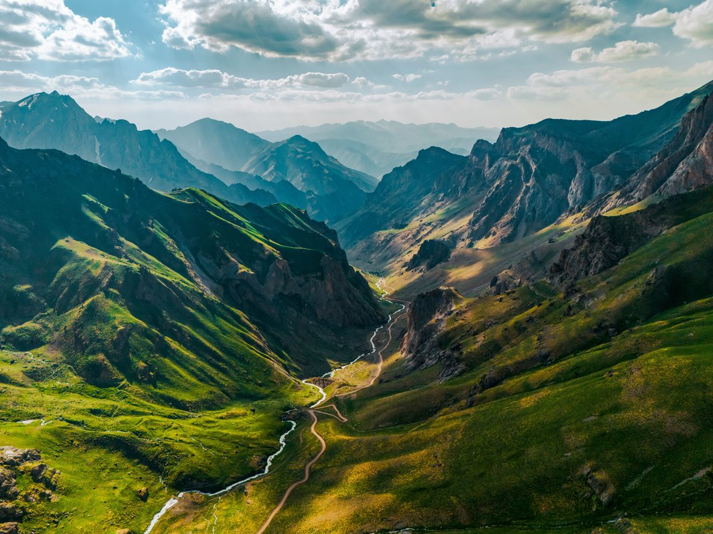

This post lives in a **leaf bundle**: `content/blog/demo-post-1/index.md` plus files in the same folder (for example `cover.svg`). The public URL is **`/blog/demo-post-1/`** from the folder name; you could override that with `slug:` in front matter if you wanted a different last segment.







This paragraph is only for a short automatic summary if you add a `<!--more-->` marker after the intro line in a longer article.

<!--more-->

## haz_img presets

Same file, different names. Resize across **480** and **768**.

### As is

Empty `ratio`. File keeps its own shape. No `auto` on `sizes`.





The picture above should look like the photograph, not a 16/9 crop and not 150px tall.

### Full, then half left (alt)

`full_to_half_left`. On a phone it is full width; on desktop it sits left and this copy should wrap. Drag across **768** to see the jump.





Wrap text for the half-desktop float. If the next block starts beside the picture, the spacer below failed.











### Quarter right

`quarter_right_sqr`. Small on every band. Copy should run down the left.





This column of words is here so the quarter square has a neighbor. On a narrow phone 25% is a thumbnail; on desktop it stays a thumbnail.













### Three-quarters, centered

`three_quarters_center_landscape`. Not floated. If it sits on the left edge, center align missed.





### Half square left (wrap + spacer)

`half_left_sqr`. Square crop, text beside it. The next heading must start below, not in the leftover column.

















### Tall frame

`full_portrait`. Same landscape file — cover should clip the sides, not squash.





### Half centered (not full)

`half_center_sqr`. Smaller than full, centered, not floated left or right.





### Third left

`third_left_sqr`. True-third width, square crop, float left. Copy should wrap the other two thirds.







### Three-quarters from half (alt)

`three_quarters_from_half`. Half centered on phone; three-quarters centered from tablet up. Drag past **480**.







## FPO section heading

1. Categories and tags drive taxonomy pages such as `/categories/notes/` and `/tags/hugo/`.
2. Those lists are generated by Hugo from your front matter, not from a hand-maintained list in the config.
3. The “archive” at `/blog/` is this section’s `_index.md` body plus Hugo’s `.Pages` list (see `layouts/section.html`).
