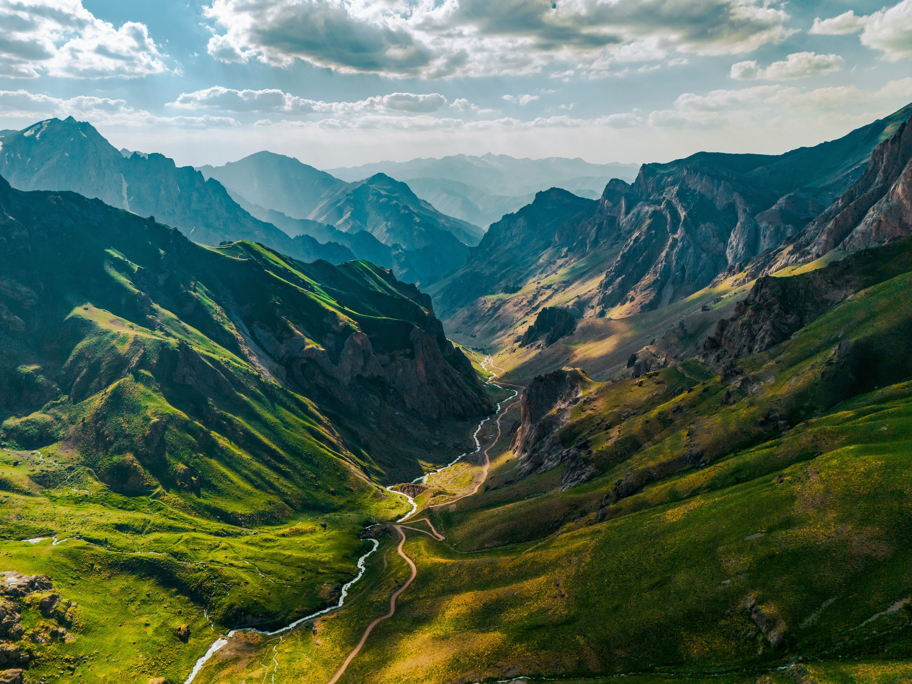

---
title: "haz_img process POC"
date: 2026-10-28T09:00:00-04:00
authors:
  - author_0001
categories:
  - Engineering
tags:
  - hugo
  - haz_img
  - demo
params:
  desc_short: "One master image; haz_img process=true builds the rwd_widths ladder."
  desc_long: "Dogfood for HQ #165. Bundle has only seed.jpg (from demo-post-1 xxl). No _xs/_sm/… files. Shortcode process=true asks Hugo to Resize missing rungs (q.jpeg from settings)."
---

POC for **process**: the page bundle has a single master (`files/seed.jpg`, from demo-post-1 `_xxl`). There are no `seed_xs.jpg` … stubs. With `process=true`, `haz_img` fills those rungs via Hugo `Resize` (width-only; quality from `rwd_widths.*.q.jpeg` / preset override).





<!--more-->

Same master, half left square (still process). CSS frame may crop display; files keep the master’s aspect.




